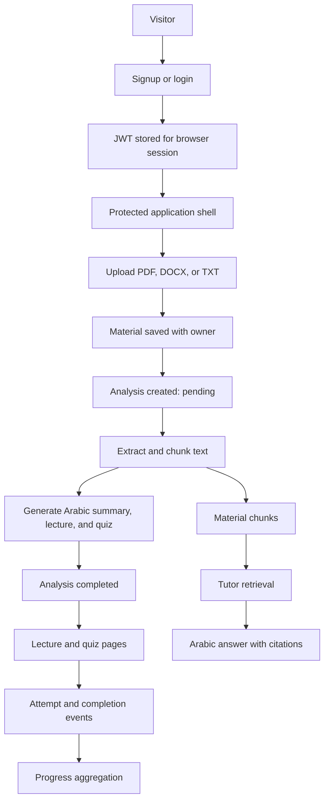

# NIPRAS Full-Stack Correctness Implementation Plan

> **For agentic workers:** REQUIRED SUB-SKILL: Use superpowers:subagent-driven-development (recommended) or superpowers:executing-plans to implement this plan task-by-task. Steps use checkbox (`- [ ]`) syntax for tracking.

**Goal:** Replace the current client-side prototype behavior with a tested, secure, persistent frontend-to-API workflow for authentication, materials, analysis, lectures, quizzes, tutor chat, study plans, and progress.

**Architecture:** The React application keeps its Arabic RTL presentation but reads authenticated resources through a single API client and route-aware auth context. The Express API validates all input, applies owner-scoped MongoDB queries, stores private files, runs a resumable single-process analysis pipeline, and exposes the existing Mongoose models through explicit controllers and routes. AI generation uses one provider adapter so business logic never depends on a vendor-specific SDK.

**Tech Stack:** React 18, Vite 5, React Router 6, Tailwind CSS 3, i18next, Vitest, React Testing Library, Express 4, MongoDB/Mongoose 8, JWT, Multer, Zod, Supertest, Node.js built-in test runner.

**Spec:** `docs/superpowers/specs/2026-09-21-nipras-full-stack-correctness-design.md`

## Current Code Logic

### Frontend startup and routing

`src/main.jsx` loads i18next, mounts `AuthProvider`, and starts `BrowserRouter`. `src/App.jsx` forces Arabic/RTL. `src/routes/AppRoutes.jsx` renders every page directly. `ProtectedRoute.jsx` exists, but it defaults `isAllowed` to `true` and is not used by any route.

### Authentication

`AuthContext.jsx` only holds `{ user: null, token: null }` in memory. Login accepts the hard-coded credentials `NIPRAS` / `123`; signup only validates local fields. Neither page calls `authService`, stores the returned token, restores a session, or logs out. Refreshing the page therefore loses auth state, while every student page remains accessible without auth.

### Materials and analysis

`materialService.js` can upload and read materials, but no page calls it. `/analysis` displays a hard-coded filename, advances a timer from 0 to 100, and redirects to the dashboard. The backend only stores the uploaded file record; it never creates an `Analysis`, extracts text, generates a lecture, or generates a quiz.

### Learning features

Dashboard, lectures, quizzes, study plan, progress, and tutor pages read mock constants or local component state. `lectureService`, `quizService`, `studyPlanService`, `progressService`, and `tutorService` are empty. Quiz submission displays a temporary message without grading. Tutor replies are fixed text. Study-plan changes and goals disappear on refresh. Progress export reports success without producing a file.

### Backend

The API connects to MongoDB and mounts auth and material routes. Models already exist for analyses, lectures, quizzes, attempts, chats, study plans, and progress, but those models have no controllers or routes. `notFound` and `errorHandler` exist but are never mounted. CORS accepts every origin. `/uploads` exposes stored files publicly. Multer assumes the upload directory already exists. `dns.js` overrides operating-system DNS for the whole process.

## Confirmed Problems and Required Corrections

| Priority | Problem | Evidence | Required correction |
|---|---|---|---|
| P0 | Authentication is bypassed | `Login/index.jsx` checks `NIPRAS` / `123`; signup only navigates | Call the API, persist the session token, hydrate `/me`, add logout, and protect student routes |
| P0 | Private routes are public | `ProtectedRoute` is unused and defaults to allowed | Base access on `AuthContext.status` and `auth.user`; redirect unauthenticated users |
| P0 | API errors can bypass the Arabic handler | `server.js` never mounts `notFound` or `errorHandler` | Register them after all routes and normalize JWT/Mongoose/Multer errors |
| P0 | Uploaded files are public | `app.use('/uploads', express.static(...))` | Replace with an authenticated owner-checked file endpoint |
| P0 | Upload can fail on a fresh checkout | Multer writes to `backend/uploads` without creating it | Create the directory at startup and test first upload |
| P0 | Frontend is disconnected from most backend models | Five services are empty; only auth/material endpoints exist | Add controllers, routes, service functions, and page integrations |
| P1 | Analysis is fake | Local `setInterval` drives progress | Create and poll a persistent `Analysis` job |
| P1 | AI tutor is fake | `handleSend` appends a fixed answer | Add retrieval, provider adapter, chat persistence, citations, and failure states |
| P1 | Quiz answers are not graded | Client only sets a toast | Grade against server-owned correct answers and store `QuizAttempt` |
| P1 | Progress and study plan are not persistent | Both pages use local constants/state | Add owner-scoped APIs and derive progress from saved activity |
| P1 | Ownership fields are inconsistent | `Material.userId`; other models use `owner` | Migrate materials to `owner` and use owner-scoped repository queries |
| P1 | Arabic-only backend data is inconsistent | `User.language` defaults to `en`; email validation is English | Default to `ar`, restrict supported value, and translate validation |
| P1 | Unsupported image types are accepted | Multer accepts JPEG/PNG/WebP; no OCR exists | Accept only PDF/DOCX/TXT until OCR is implemented |
| P1 | Invalid IDs and duplicate email races can become 500s | No ObjectId validation; only pre-check for duplicate email | Validate params and map `CastError`, validation, and error code 11000 |
| P1 | DNS is globally overridden | `backend/config/dns.js` always sets public resolvers | Remove it from normal startup; make custom DNS an explicit opt-in diagnostic |
| P2 | Many controls are inert | Google, forgot password, footer links, settings, several lesson/quiz actions | Implement a real action or remove/disable each control |
| P2 | Search boxes imply unsupported behavior | Shared navbar renders editable search without handlers | Add controlled search/filter behavior or render a non-interactive label |
| P2 | No automated test command exists | Root and backend packages have no behavior test suites | Add frontend component tests, API integration tests, and one browser smoke path |
| P2 | Deployment configuration is incomplete | No client origin, AI, storage, or upload limits documented | Expand `.env.example`, README, health check, and production startup guidance |

## Target End-to-End Logic



## Global Constraints

- Keep the Arabic-only runtime and RTL fixes already implemented.
- Preserve existing public paths where possible; add parameterized paths without breaking old bookmarks.
- Never expose another user's material, analysis, lecture, quiz, attempt, chat, plan, progress, or file.
- Never send `correctOption`, password hashes, AI keys, stack traces, or local storage paths to the browser.
- Keep mock data only as development fixtures; production pages must use API responses.
- Every mutation must show loading, success, validation, and retryable failure behavior.
- Do not claim AI output is authoritative; keep the current textbook-verification warning.

## Review Focus

- Expired, malformed, or deleted-user JWTs must clear the frontend session and redirect to login; Task 2 owns this test.
- A user requesting another user's ID or file must receive 404 without revealing that the resource exists; Tasks 3–8 each test ownership.
- Server restart during analysis must not leave a permanent `processing` item; Task 4 tests recovery.
- AI output that is invalid JSON, empty, or timed out must mark analysis failed and leave uploaded material recoverable; Task 4 tests all three.
- Double-clicking submit/upload/message buttons must not create duplicate attempts, jobs, or chat messages; the owning task adds disabled-state or idempotency tests.

---

### Task 1: Establish Test, Configuration, and Server Foundations

**Files:**
- Modify: `package.json`
- Modify: `backend/package.json`
- Modify: `backend/.env.example`
- Create: `.env.example`
- Modify: `backend/server.js`
- Modify: `backend/config/env.js`
- Modify: `backend/config/dns.js`
- Modify: `backend/middleware/errorMiddleware.js`
- Create: `backend/app.js`
- Create: `backend/middleware/validate.js`
- Create: `backend/utils/apiError.js`
- Create: `backend/tests/health.test.js`
- Create: `src/test/setup.js`
- Create: `vitest.config.js`

**Interfaces:**
- Produces `createApp()` for tests and `app` for `server.js`.
- Produces `ApiError(status, code, message, details)` and `validate(schema, source)`.
- Adds `GET /api/health` returning `{ status: "ok" }`.

- [ ] **Step 1: Add test dependencies and commands**

Root scripts and dev dependencies:

```json
{
  "scripts": {
    "test": "vitest run",
    "test:watch": "vitest",
    "test:backend": "npm --prefix backend test",
    "test:all": "npm test && npm run test:backend"
  },
  "devDependencies": {
    "@testing-library/jest-dom": "^6.6.3",
    "@testing-library/react": "^16.1.0",
    "@testing-library/user-event": "^14.5.2",
    "jsdom": "^25.0.1",
    "vitest": "^2.1.8"
  }
}
```

Backend additions:

```json
{
  "scripts": { "test": "node --test tests/*.test.js" },
  "dependencies": {
    "express-rate-limit": "^7.5.0",
    "helmet": "^8.0.0",
    "zod": "^3.24.1"
  },
  "devDependencies": {
    "mongodb-memory-server": "^10.1.4",
    "supertest": "^7.0.0"
  }
}
```

- [ ] **Step 2: Write a failing health/error test**

Test `GET /api/health`, an unknown route, and invalid JSON. Assert the health response is 200, unknown routes use Arabic `{ message, code }`, and neither response exposes `stack`.

- [ ] **Step 3: Split application creation from process startup**

Move middleware and routes into `backend/app.js`. Keep Mongo connection and `listen()` in `server.js`. Register middleware in this exact order:

```js
app.use(helmet());
app.use(cors({ origin: allowedOrigins, credentials: false }));
app.use(express.json({ limit: "1mb" }));
app.get("/api/health", (_req, res) => res.json({ status: "ok" }));
app.use("/api/auth", authRoutes);
app.use("/api/materials", materialRoutes);
// Remaining routes are mounted by their owning tasks.
app.use(notFound);
app.use(errorHandler);
```

Do not import `config/dns.js` from normal startup. If `CUSTOM_DNS_SERVERS` is set, parse that comma-separated value inside the database diagnostic command only.

- [ ] **Step 4: Validate required configuration once**

`env.js` must parse `PORT`, `MONGO_URI` or `MONGO_URI_STANDARD`, `JWT_SECRET`, `CLIENT_ORIGINS`, `MAX_FILE_SIZE_MB`, `AI_BASE_URL`, `AI_API_KEY`, `AI_MODEL`, and `AI_EMBEDDING_MODEL`. Production startup must fail before listening when a required value is missing. The root `.env.example` contains `VITE_API_URL=http://localhost:5000/api`. Parse `CLIENT_ORIGINS` as a comma-separated allowlist and reject unknown browser origins.

- [ ] **Step 5: Run and commit**

Run `npm install`, `npm --prefix backend install`, `npm run test:backend`, and `npm run build`. Expected: all pass.

Commit: `test: establish API and frontend test foundations`

### Task 2: Connect Authentication and Protect Routes

**Files:**
- Modify: `src/context/AuthContext.jsx`
- Modify: `src/routes/ProtectedRoute.jsx`
- Modify: `src/routes/AppRoutes.jsx`
- Modify: `src/pages/Login/index.jsx`
- Modify: `src/pages/Signup/index.jsx`
- Modify: `src/services/api.js`
- Modify: `src/services/authService.js`
- Modify: `backend/controllers/authController.js`
- Modify: `backend/middleware/authMiddleware.js`
- Modify: `backend/models/User.js`
- Create: `src/services/authStorage.js`
- Create: `src/pages/Login/Login.test.jsx`
- Create: `backend/tests/auth.test.js`

**Interfaces:**
- `AuthContext` exposes `{ user, token, status, signIn, signUp, signOut }`.
- `status` is exactly `"loading" | "authenticated" | "anonymous"`.
- `apiRequest(path, { token, signal, ...options })` throws an error with `.status` and `.code`.

- [ ] **Step 1: Write failing auth tests**

Cover signup, login, `/me`, duplicate email, invalid email, short password, invalid JWT, session hydration, failed login UI, submit disabled while pending, logout, and protected-route redirect.

- [ ] **Step 2: Make API requests predictable**

Only set `Content-Type: application/json` when the body is not `FormData`. Parse 204 and non-JSON responses safely. Convert network failure into `تعذّر الاتصال بالخادم`. On 401, dispatch a `nipras:unauthorized` browser event.

- [ ] **Step 3: Persist and hydrate the session**

Store only the JWT in `sessionStorage` under `nipras_session_token`. On provider mount, call `getMe(token)`. Clear the token on failure or `nipras:unauthorized`. `ProtectedRoute` must render a full-page loading indicator while status is `loading`, children while authenticated, and `<Navigate to="/login" replace state={{ from: location }} />` otherwise.

- [ ] **Step 4: Replace prototype forms with API mutations**

Login must use `type="email"`, call `signIn({ email, password })`, then navigate to `location.state.from.pathname || "/dashboard"`. Signup must submit `{ fullName, email, password, stream: "scientific", grade: "12" }`. Remove inactive Google buttons. Do not navigate when the API rejects.

- [ ] **Step 5: Strengthen backend auth**

Require a valid email and an 8-character password. Catch duplicate-key code `11000`. Set `language: "ar"`; change the model enum/default to Arabic only. Convert JWT expiration/signature errors into `ApiError(401, "AUTH_INVALID", "انتهت الجلسة أو رمز الدخول غير صالح")`.

- [ ] **Step 6: Protect routes and add logout**

Keep `/`, `/login`, and `/signup` public. Wrap `/analysis`, `/dashboard`, `/lectures`, `/lesson/*`, `/study-plan`, `/progress`, `/quizzes`, and `/ai-tutor`. Add logout to the sidebar profile area.

- [ ] **Step 7: Verify and commit**

Run `npm test -- Login`, `npm run test:backend`, and `npm run build`.

Commit: `feat: connect authentication and protect student routes`

### Task 3: Make Material Upload and File Access Private

**Files:**
- Modify: `backend/models/Material.js`
- Modify: `backend/controllers/materialController.js`
- Modify: `backend/routes/materialRoutes.js`
- Modify: `backend/middleware/uploadMiddleware.js`
- Modify: `src/services/materialService.js`
- Modify: `src/components/layout/Sidebar.jsx`
- Create: `backend/services/fileStorage.js`
- Create: `backend/scripts/migrateMaterialOwner.js`
- Create: `backend/tests/materials.test.js`
- Create: `src/pages/Materials/index.jsx`
- Create: `src/pages/Materials/Materials.test.jsx`

**Interfaces:**
- Material shape: `{ _id, owner, title, mimeType, originalName, sizeBytes, status, uploadedAt }`.
- Routes: `POST /api/materials`, `GET /api/materials`, `GET /api/materials/:id`, `GET /api/materials/:id/file`, and `DELETE /api/materials/:id`.

- [ ] **Step 1: Write failing upload and ownership tests**

Test allowed MIME types, the size limit, a missing file, upload-directory creation, list/detail/delete, authenticated download, and cross-user requests returning 404.

Add `file-type` to backend dependencies. Use `fileTypeFromFile(path)` for PDF/DOCX signatures and a strict UTF-8 decoding check for TXT files.

- [ ] **Step 2: Standardize the schema**

Rename `userId` to `owner`; add `mimeType`, `originalName`, `sizeBytes`, and `storageKey`. The migration copies `userId` into `owner` only when `owner` is absent, then unsets `userId`.

- [ ] **Step 3: Restrict and validate upload types**

Allow `application/pdf`, `text/plain`, and DOCX only. Create `backend/uploads` recursively before Multer initializes. Validate both MIME type and file signature after upload; delete rejected temporary files.

- [ ] **Step 4: Remove public static file serving**

Delete `app.use("/uploads", express.static(...))`. Stream files only after querying `{ _id: req.params.id, owner: req.user._id }`. Use `Content-Disposition: inline; filename*=UTF-8''...` without exposing the server path.

- [ ] **Step 5: Build the materials page**

Show a file picker, title, upload progress, list, open, retry, delete, loading, empty, and error states. After successful upload navigate to `/analysis/:materialId`. Point sidebar `uploadMaterial` to `/materials` and `myMaterials` to `/materials`.

- [ ] **Step 6: Verify and commit**

Run material API tests, frontend materials tests, and the build.

Commit: `feat: add private material upload and library`

### Task 4: Implement the Real Analysis and Content-Generation Pipeline

**Files:**
- Modify: `backend/models/Analysis.js`
- Modify: `src/pages/Analysis/index.jsx`
- Modify: `src/routes/AppRoutes.jsx`
- Create: `backend/models/MaterialChunk.js`
- Create: `backend/controllers/analysisController.js`
- Create: `backend/routes/analysisRoutes.js`
- Create: `backend/services/textExtractionService.js`
- Create: `backend/services/chunkingService.js`
- Create: `backend/services/aiProvider.js`
- Create: `backend/services/analysisService.js`
- Create: `backend/services/analysisRunner.js`
- Create: `backend/validation/aiSchemas.js`
- Create: `src/services/analysisService.js`
- Create: `backend/tests/analysis.test.js`
- Create: `src/pages/Analysis/Analysis.test.jsx`

**Interfaces:**
- `POST /api/analyses` body `{ materialId }` returns 202 `{ analysis }`.
- `GET /api/analyses/:id` returns owner-scoped status and progress.
- `POST /api/analyses/:id/cancel` changes pending/processing jobs to `canceled`, stores code `ANALYSIS_CANCELED`, and returns the material to `uploaded` so the student can retry.
- Status progression: `pending -> processing -> completed | failed | canceled`; progress never decreases.

- [ ] **Step 1: Add extraction dependencies and failing tests**

Add `pdf-parse` and `mammoth`. Test TXT, PDF, and DOCX extraction fixtures; empty content; provider timeout; invalid provider JSON; cancellation; cross-user access; and recovery of stale processing jobs.

- [ ] **Step 2: Implement extraction and chunking**

Normalize whitespace, retain page/section labels, split into roughly 800-token chunks with 120-token overlap, and save `{ owner, material, text, order, sourceLabel, embedding }`.

- [ ] **Step 3: Implement the provider adapter**

Use native `fetch` with an `AbortController` timeout. Expose:

```js
generateStructured({ system, prompt, schemaName })
embedTexts(texts)
```

Reject missing credentials with Arabic code `AI_NOT_CONFIGURED`; reject invalid output with `AI_INVALID_RESPONSE`. Never log the API key or full student material.

Define Zod schemas for the generated summary, lecture sections, quiz questions, and citations in `aiSchemas.js`. Parse provider JSON through these schemas before any database write.

- [ ] **Step 4: Generate saved resources**

The analysis runner updates progress at extraction, chunking, embedding, generation, and persistence milestones. In one Mongo session, create the lecture and quiz, mark the material `analyzed`, and mark analysis `completed`. On failure, set both analysis and material to `failed` while keeping the file available for retry.

- [ ] **Step 5: Replace the timer UI**

Read `materialId` from the route, create/reuse an active analysis, poll every two seconds, render server progress/error, cancel through the API, and navigate to `/lectures/:lectureId` on completion. Keep `/analysis` as a redirect to `/materials` for old links.

- [ ] **Step 6: Verify and commit**

Run analysis service/API/component tests and the production build.

Commit: `feat: generate lessons and quizzes from uploaded materials`

### Task 5: Connect Lectures and Lesson Completion

**Files:**
- Modify: `backend/models/Lecture.js`
- Modify: `src/services/lectureService.js`
- Modify: `src/pages/Lectures/index.jsx`
- Modify: `src/pages/Lesson/index.jsx`
- Modify: `src/routes/AppRoutes.jsx`
- Create: `backend/controllers/lectureController.js`
- Create: `backend/routes/lectureRoutes.js`
- Create: `backend/models/LectureProgress.js`
- Create: `backend/tests/lectures.test.js`
- Create: `src/pages/Lectures/Lectures.test.jsx`

**Interfaces:**
- `GET /api/lectures`, `GET /api/lectures/:id`, and `POST /api/lectures/:id/complete`.
- `GET /api/lectures/:id` returns lecture sections plus `{ completed, completedAt }` for the current user.

- [ ] **Step 1: Write failing lecture tests**

Cover list, detail, material filter, section order, ownership, empty state, loading failure, and idempotent completion.

- [ ] **Step 2: Add owner-scoped lecture endpoints**

Sort sections by `order`. Never return draft lectures unless they belong to the authenticated owner. Completion must upsert one `LectureProgress` record.

- [ ] **Step 3: Replace mock lecture data**

Load `/lectures/:id`; keep topic selection local but source it from `lecture.sections`. Add `/lectures` as a library list. Make “تنزيل الدرس” create a UTF-8 text download, “إنشاء اختبار” navigate to the linked quiz, and remove simulation/remedial buttons until their features exist.

- [ ] **Step 4: Reuse the lesson player safely**

Map API sections into the player slide structure without executing HTML. Mark completion only after the last slide. Preserve keyboard controls, Arabic narration fallback, and LTR math wrappers.

- [ ] **Step 5: Verify and commit**

Run lecture tests, lesson interaction tests, and build.

Commit: `feat: serve generated lectures and completion state`

### Task 6: Implement Server-Graded Quizzes

**Files:**
- Modify: `backend/models/Quiz.js`
- Modify: `backend/models/QuizAttempt.js`
- Modify: `src/services/quizService.js`
- Modify: `src/pages/Quizzes/index.jsx`
- Modify: `src/routes/AppRoutes.jsx`
- Create: `backend/controllers/quizController.js`
- Create: `backend/routes/quizRoutes.js`
- Create: `backend/tests/quizzes.test.js`
- Create: `src/pages/Quizzes/Quizzes.test.jsx`

**Interfaces:**
- `GET /api/quizzes`, `GET /api/quizzes/:id`, `POST /api/quizzes/:id/attempts`, and `PATCH /api/quiz-attempts/:attemptId/answers`.
- Quiz detail omits `correctOption` and explanation until the relevant answer is submitted.

- [ ] **Step 1: Write failing quiz security and grading tests**

Assert correct answers never appear in the initial payload, server grading is accurate, foreign quiz/attempt IDs return 404, duplicate answer submission is idempotent, and completion calculates a 0–100 score.

- [ ] **Step 2: Implement attempt lifecycle**

Create one active attempt per user/quiz, validate `questionId` and option labels, grade from the database, record `answeredAt`, and set `completedAt` after every question has an answer.

- [ ] **Step 3: Replace the one-question mock page**

Load quiz by route ID, maintain the current index, disable submit until selection, display returned explanation, implement previous/skip/next, show completion summary, and preserve Arabic accessibility labels.

- [ ] **Step 4: Verify and commit**

Run quiz API/component tests and build.

Commit: `feat: add persistent server-graded quizzes`

### Task 7: Implement Retrieval-Based Tutor Chat

**Files:**
- Modify: `backend/models/AIChat.js`
- Modify: `src/services/tutorService.js`
- Modify: `src/pages/AITutor/MainChat.jsx`
- Modify: `src/pages/AITutor/RightStudyPanel.jsx`
- Create: `backend/controllers/tutorController.js`
- Create: `backend/routes/tutorRoutes.js`
- Create: `backend/services/retrievalService.js`
- Create: `backend/services/tutorService.js`
- Create: `backend/tests/tutor.test.js`
- Create: `src/pages/AITutor/AITutor.test.jsx`

**Interfaces:**
- `POST /api/chats` creates `{ materialId?, title? }`.
- `GET /api/chats/:id` returns persisted messages.
- `POST /api/chats/:id/messages` body `{ content, clientMessageId }` returns `{ userMessage, assistantMessage }` with citations.

- [ ] **Step 1: Write failing tutor tests**

Cover ownership, empty message, material ownership, top-chunk retrieval, provider timeout, citation shape, duplicate `clientMessageId`, UI pending state, retry, and Enter versus Shift+Enter.

- [ ] **Step 2: Implement retrieval**

Embed the question, compute cosine similarity against the selected material's chunks, and pass only the top five chunks to the provider. Each citation must include `materialId`, `sourceLabel`, and a short excerpt.

- [ ] **Step 3: Persist messages safely**

Save the user message before generation. Save an assistant error state when generation fails so retry is possible. Limit input to 4,000 characters and chat history sent to the provider to the latest 12 messages.

- [ ] **Step 4: Replace fixed chat content**

Load material choices and chat history, submit through `tutorService`, render citations as buttons that open the authenticated file endpoint, keep the textbook warning, and remove fixed chemistry-only answers.

- [ ] **Step 5: Verify and commit**

Run tutor tests and build.

Commit: `feat: connect tutor chat to material retrieval`

### Task 8: Persist Study Plans, Goals, Dashboard, and Progress

**Files:**
- Modify: `backend/models/StudyPlan.js`
- Modify: `backend/models/Progress.js`
- Modify: `src/services/studyPlanService.js`
- Modify: `src/services/progressService.js`
- Modify: `src/pages/StudyPlan/index.jsx`
- Modify: `src/pages/Progress/index.jsx`
- Modify: `src/pages/Dashboard/index.jsx`
- Create: `backend/controllers/studyPlanController.js`
- Create: `backend/controllers/progressController.js`
- Create: `backend/routes/studyPlanRoutes.js`
- Create: `backend/routes/progressRoutes.js`
- Create: `backend/services/progressService.js`
- Create: `backend/tests/study-plan-progress.test.js`
- Create: `src/pages/Progress/Progress.test.jsx`

**Interfaces:**
- `GET/PUT /api/study-plan`, `PATCH /api/study-plan/tasks/:taskId`, `GET /api/progress`, and `GET /api/progress/report.csv`.
- Dashboard consumes the same progress, plan, lecture, and quiz resources rather than a separate mock contract.

- [ ] **Step 1: Write failing persistence and aggregation tests**

Cover task toggling, task ownership, plan replacement, empty plan, lecture completion count, quiz average, study minutes, streak calculation, CSV download headers, and dashboard loading/error states.

- [ ] **Step 2: Implement study-plan mutations**

Upsert one active plan per owner. Toggle tasks by `_id`, set/clear `completedAt`, and validate dates/durations. “إعادة تجهيز الخطة” must request a new AI-generated plan using the exam date and current weak areas; it must never silently overwrite without confirmation.

- [ ] **Step 3: Derive progress from saved events**

Calculate values from `LectureProgress`, completed `QuizAttempt` documents, and study-plan tasks. Cache the aggregate in `Progress`, but rebuild it when relevant mutations complete. Use Asia/Hebron day boundaries for streaks.

- [ ] **Step 4: Connect all three pages**

Replace mock constants with API data. Save goals, produce a real CSV file, make dashboard plan rows navigate to their resources, carry the dashboard tutor question into `/ai-tutor`, and use the authenticated user's real name.

- [ ] **Step 5: Verify and commit**

Run progress/plan/dashboard tests and build.

Commit: `feat: persist plans and aggregate learning progress`

### Task 9: Resolve Inert Controls and Complete Navigation

**Files:**
- Modify: `src/components/layout/Navbar.jsx`
- Modify: `src/components/layout/Footer.jsx`
- Modify: `src/components/layout/Sidebar.jsx`
- Modify: `src/pages/Landing/index.jsx`
- Modify: `src/pages/Login/index.jsx`
- Modify: `src/pages/Signup/index.jsx`
- Modify: pages changed in Tasks 5–8
- Create: `src/pages/Static/About.jsx`
- Create: `src/pages/Static/Privacy.jsx`
- Create: `src/pages/Static/Terms.jsx`
- Create: `src/pages/Static/Support.jsx`
- Create: `src/pages/NotFound/index.jsx`
- Create: `src/components/layout/AppShell.jsx`
- Create: `src/components/layout/AppShell.test.jsx`

**Interfaces:**
- Shared app pages use `AppShell({ activeItem, children })`.
- Search accepts `{ value, onChange, onSubmit }`; without handlers it renders disabled with an Arabic explanation.

- [ ] **Step 1: Inventory every interactive element in a failing browser test**

Cover landing anchors, forgot password, footer pages, sidebar materials/settings/logout, notifications/help, lecture actions, quiz navigation, tutor sources, and progress recommendations. The test fails if clicking a visible enabled control produces no state, navigation, download, or dialog change.

- [ ] **Step 2: Implement supported navigation**

Use real anchors for landing sections. Add static policy/support routes. Add a not-found page instead of redirecting every unknown URL. Remove the settings item until a settings API exists. Render password reset disabled with `غير متاح حاليًا` until email delivery is configured.

- [ ] **Step 3: Remove unsupported promises**

Remove Google OAuth buttons, laboratory simulation, notifications, and other actions that have no backend contract. Do not leave decorative `<button>` elements.

- [ ] **Step 4: Consolidate the application shell**

Move repeated sidebar/navbar/footer markup into `AppShell`. Preserve the existing responsive RTL behavior, focus trapping for overlays, Escape closing, and scroll locking.

- [ ] **Step 5: Verify and commit**

Run the interaction inventory, accessibility-focused component tests, and build.

Commit: `fix: connect all visible controls and navigation`

### Task 10: Production Hardening, Documentation, and End-to-End Verification

**Files:**
- Modify: `.gitignore`
- Modify: `backend/.gitignore`
- Modify: `backend/.env.example`
- Create: `README.md`
- Create: `.github/workflows/ci.yml`
- Create: `tests/e2e/student-flow.spec.js`
- Create: `playwright.config.js`

**Interfaces:**
- CI runs install, frontend tests, backend tests, build, and end-to-end smoke tests.

- [ ] **Step 1: Remove tracked/generated artifacts**

Ensure `node_modules`, `.npm-cache`, `dist`, uploads, logs, real `.env` files, and generated reports are ignored and not tracked. Keep only lockfiles and `.env.example`. After confirming the paths, remove already tracked generated artifacts with `git rm -r --cached .npm-cache dist` so the local files remain available but future commits stop carrying them.

- [ ] **Step 2: Document exact setup**

README commands:

```powershell
npm ci
npm --prefix backend ci
Copy-Item backend/.env.example backend/.env
npm --prefix backend run dev
npm run dev -- --host 127.0.0.1
```

Document MongoDB creation, AI variables, client origins, supported file types, test commands, build command, and demo-data seeding.

- [ ] **Step 3: Add CI and browser flow**

The Playwright test must create a user, upload a TXT fixture, wait for analysis, open the generated lesson, complete one quiz, ask one cited tutor question, toggle a study-plan task, and verify progress changed. Stub only the external AI HTTP server; use the real app/API/Mongo test database.

- [ ] **Step 4: Run the complete verification matrix**

Run:

```powershell
npm run test:all
npm run build
npx playwright test
```

Verify `/`, auth, materials, analysis, dashboard, lectures, lesson, quizzes, tutor, study plan, progress, static pages, and 404 at 1440×900, 768×1024, and 390×844. Require zero uncaught console errors and no horizontal document overflow.

- [ ] **Step 5: Security and failure review**

Test invalid JWT, expired JWT, duplicate signup, oversized upload, disguised executable upload, cross-user IDs, Mongo unavailable, AI unavailable, provider timeout, invalid AI JSON, restart during analysis, double submit, and direct deep-link refresh.

- [ ] **Step 6: Commit**

Commit: `chore: add production verification and project documentation`

## Recommended Execution Order

Tasks 1–3 are the minimum safe foundation. Task 4 unlocks the real product flow. Tasks 5–8 can then be implemented in order because they share generated IDs and progress events. Task 9 removes misleading controls after supported actions are known. Task 10 verifies the complete system.

Do not start frontend mock replacement before Tasks 1–4 define stable API response shapes. Do not start tutor retrieval before material chunks exist. Do not calculate progress before lecture completion and quiz attempts are persistent.
